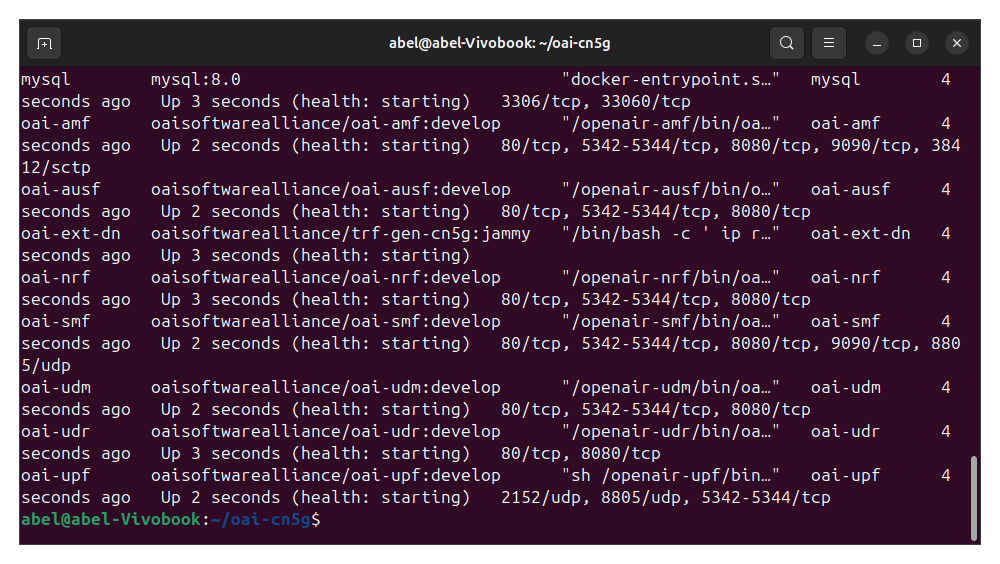
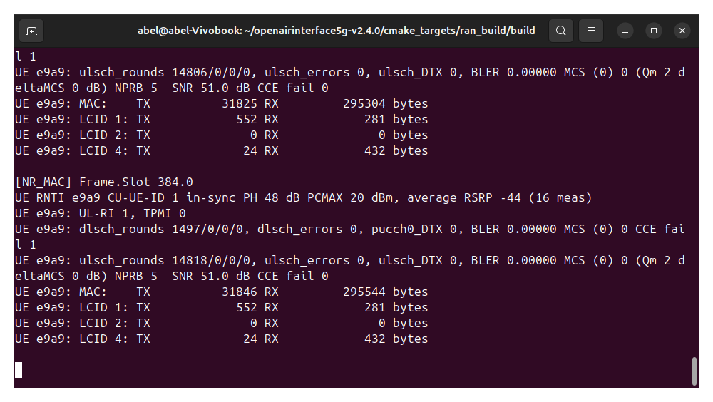
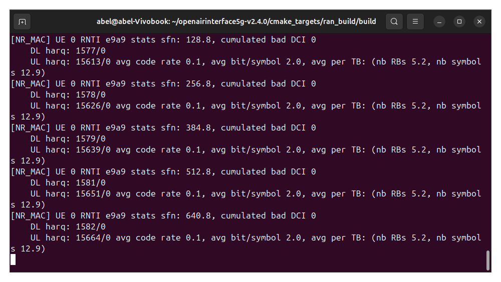
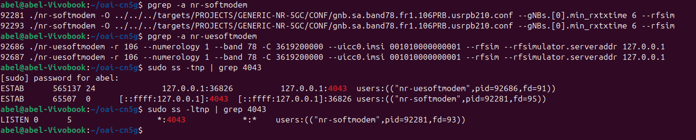
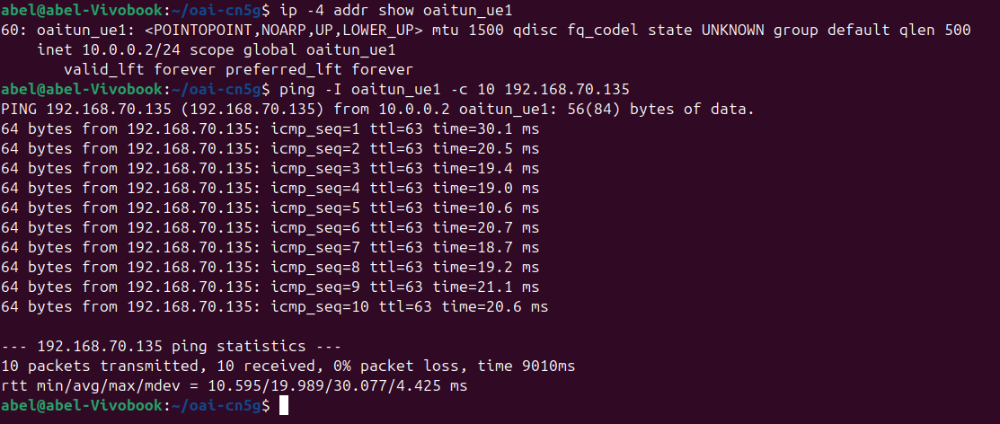
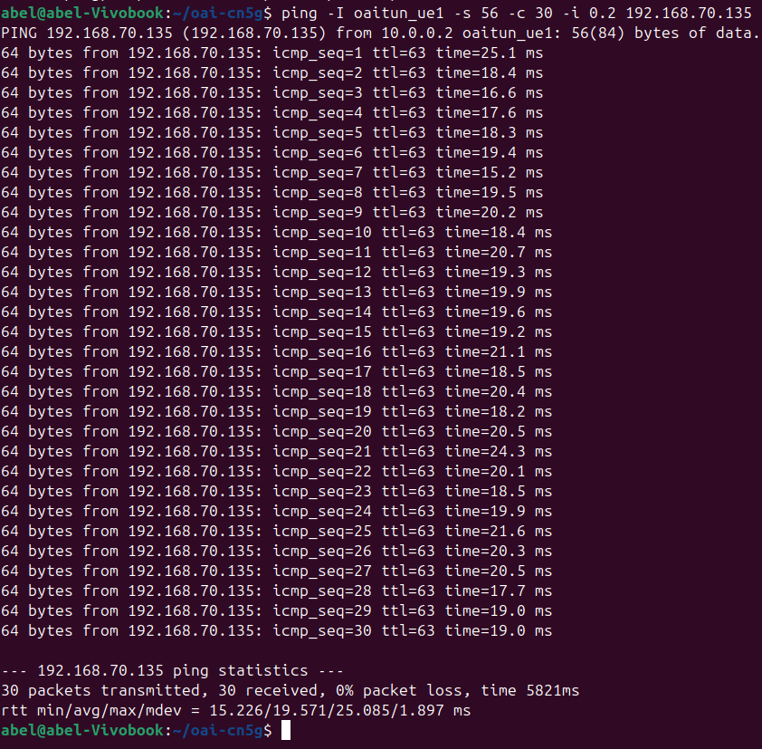
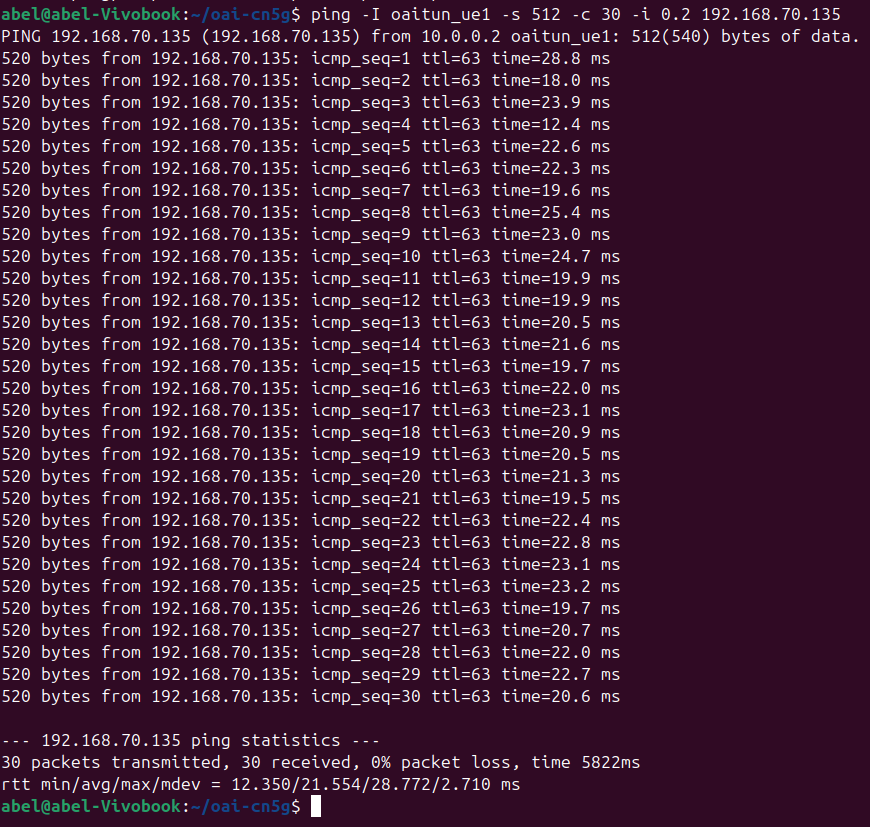
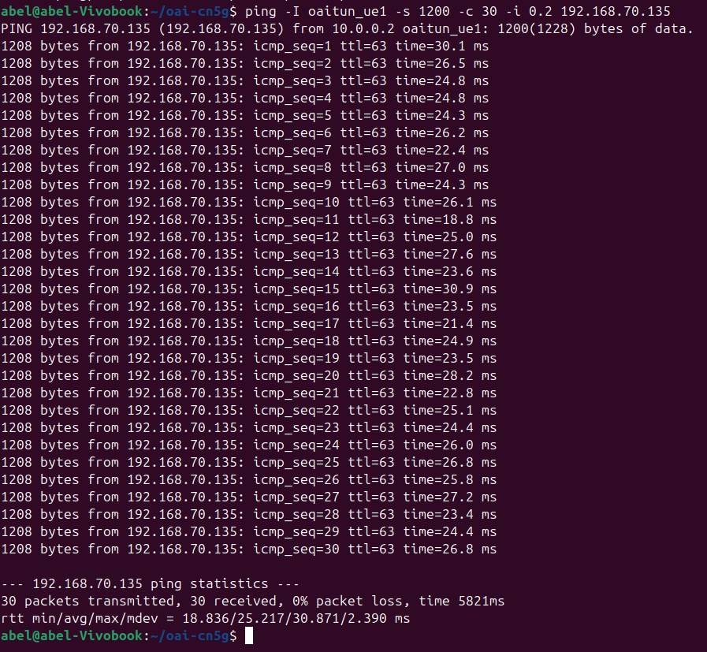
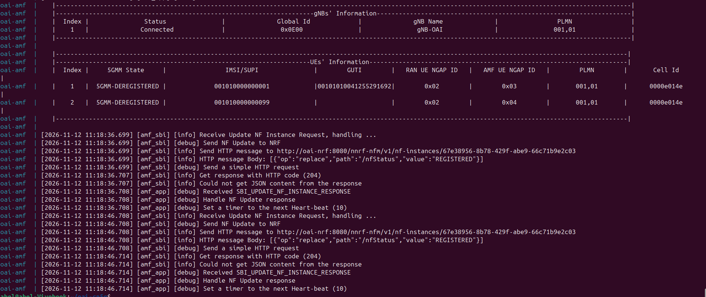
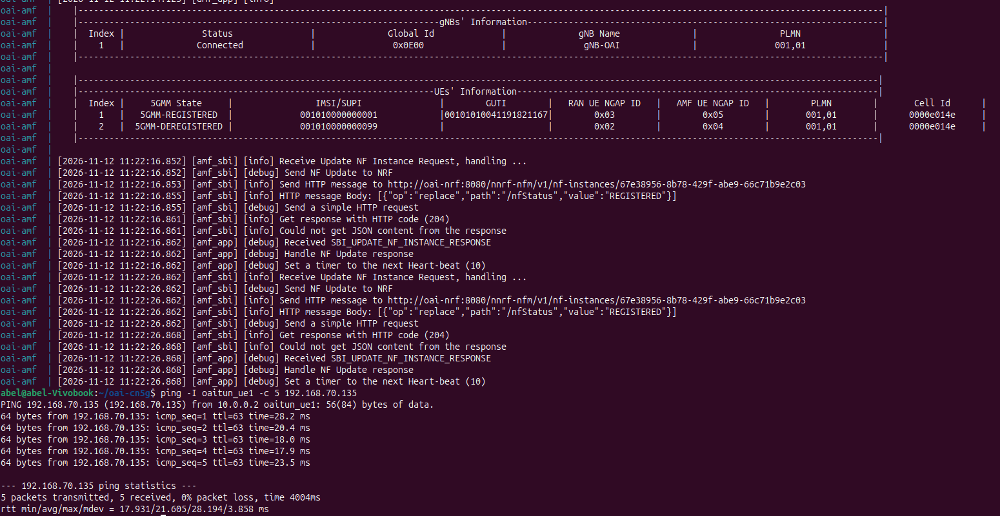

# Lab 3: Deploying a 5G Standalone Network Using OpenAirInterface

## 1. Goal

In the previous labs, you analyzed 5G signaling messages and network performance using provided captures and measurements.

In this lab, you will deploy your own 5G Standalone (SA) network using OpenAirInterface (OAI), verify the complete connection, investigate RFsimulator communication, perform active network measurements, and troubleshoot a controlled connection failure.

Unlike the previous labs, you will collect measurements directly from your own running 5G network.

**Learning Objectives**

After completing this lab, you should be able to:

1. Deploy an OAI gNB, nrUE, and 5G Core Network.
2. Identify the main stages of 5G SA connection establishment.
3. Verify communication between gNB and nrUE through RFsimulator.
4. Measure user-plane connectivity under different packet sizes.
5. Diagnose connection failures using OAI and 5GC logs.
6. Explain the limitations of a software-simulated 5G network.

## 2. Experimental Environment

Use the *OAI v2.4.0 Build Guide* to prepare the environment before class.

| Component | Configuration |
|---|---|
| Ubuntu | 24.04 |
| OAI RAN | v2.4.0 |
| 5G Core | OAI CN5G |
| gNB | nr-softmodem |
| UE | nr-uesoftmodem |
| Radio interface | RFsimulator |
| Band | n78 |
| Subcarrier spacing | 30 kHz |
| Resource blocks | 106 |
| UE IMSI | 001010000000001 |
| External DN | 192.168.70.135 |

The experiment uses one Ubuntu machine without physical RF hardware.

## 3. Task 1 — Deploy and Verify the Complete 5G SA Network

Start the OAI CN5G:

```bash
cd ~/oai-cn5g
docker compose up -d
docker compose ps
```

Start the gNB and nrUE using the commands in the Build Guide.

Observe their terminal outputs and locate evidence of the following stages.

Stage | Successful? | Evidence from logs |
|---|---|---|
| CN5G initialization | Yes | **Terminal 1 (`docker compose ps`):** All core network containers (`oai-amf`, `oai-smf`, `oai-upf`, `oai-ausf`, `oai-udm`, `oai-udr`, `oai-nrf`, `oai-ext-dn`, `mysql`) show the status `Up` or `Up (healthy)`. |
| gNB NG Setup | Yes | **Terminal 2 (gNB):** `[NGAP] Send NGSetupRequest to AMF` followed by `[NGAP] Received NGSetupResponse from AMF` (and in AMF logs: `Connected gNB` with the `gNB-ID`). |
| UE synchronization | Yes | **Terminal 3 (nrUE):** `[PHY] Initial sync successful, PCI: 0` (confirms PSS/SSS detection, PBCH/MIB decoding, and time/frequency synchronization with the cell). |
| RRC connection establishment | Yes | **Terminal 3 (nrUE) & Terminal 2 (gNB):** Random Access Msg1–Msg4 exchange (`[MAC] [UE 0] Send PRACH`, `Received RAR`), followed by `[RRC] [UE 0] State = NR_RRC_CONNECTED` (and `RRCSetupComplete` on the gNB side). |
| UE Registration | Yes | **Terminal 3 (nrUE) & AMF logs:** On UE: `[NAS] [UE 0] Received Registration Accept` and `Registration Complete` sent. On AMF (`docker logs oai-amf`): UE (IMSI `001010000000001`) transitions to `5GMM-REGISTERED`. |
| PDU Session Establishment | Yes | **Terminal 3 (nrUE) & SMF logs:** On UE: `[NAS] Received PDU Session Establishment Accept` (including IP address allocation, e.g., `10.0.0.2` or `12.1.1.2`). On gNB: `PDU Session Resource Setup Request/Response`. |
| UE tunnel creation | Yes | **Terminal 3 (nrUE) & Terminal 4:** In UE logs: `Interface oaitun_ue1 successfully configured, ip address ...`. Verified via `ip addr show oaitun_ue1` showing the `UP` interface with its assigned IPv4 address. |

Take screenshots showing the gNB and UE successfully connected: 

- Docker :
  

- gNB :
  

- UE :
  


**Questions:**

1. **Does a successful NG Setup guarantee that a UE can register? Explain.**
   No. A successful NG Setup only verifies that the N2 interface (SCTP/NGAP) between the gNB and the AMF is operational and that their RAN/Core configurations (such as PLMN ID and TAC) are compatible. UE registration depends on additional end-to-end conditions, including successful radio synchronization and RRC connection establishment over the air interface, valid subscriber credentials (IMSI, K, OPc) provisioned in the UDM/UDR database, and functional signaling between the AMF, AUSF, UDM, and UDR.

2. **Why can the UE establish an RRC connection but still fail Registration?**
   RRC connection establishment occurs strictly at the Access Stratum (AS) level between the UE and the gNB, before any subscriber identity verification takes place. Once the RRC connection is established, the UE sends a NAS Registration Request that the gNB forwards to the AMF. Registration can still fail at the Non-Access Stratum (NAS) level due to an unknown or unprovisioned IMSI in the core network database, mismatched authentication keys (5G-AKA failure), an unsupported slice (S-NSSAI), or PLMN/tracking area restrictions.

3. **What additional procedure is required after Registration before user data can be exchanged?**
   After Registration, the UE must complete the **PDU Session Establishment** procedure. This procedure sets up the user-plane path (N3 GTP-U tunnel between the gNB and UPF, plus the Data Radio Bearers between the gNB and UE), allocates an IP address to the UE, and configures the local virtual tunnel interface (`oaitun_ue1`) so user-plane IP traffic can flow to and from the External Data Network.

## 4. Task 2 — Investigate RFsimulator Communication

OAI RFsimulator replaces the physical RF interface with software-based communication.

The gNB and nrUE exchange IQ samples through a TCP connection.

Check the running processes:

```bash
pgrep -a nr-softmodem
pgrep -a nr-uesoftmodem
```

Inspect the TCP connections:

```bash
sudo ss -tnp | grep 4043
```

If necessary, inspect the listener:

```bash
sudo ss -ltnp | grep 4043
```

The default RFsimulator port in this experiment is 4043.

Complete the table:

| Item | Observed Value |
|---|---|
| gNB process ID | `92281` (sudo parent: `92293`) |
| nrUE process ID | `92686` (sudo parent: `92687`) |
| RFsimulator transport protocol | TCP |
| RFsimulator port | `4043` |
| TCP connection state | `ESTAB` (and `LISTEN` on gNB) |
| Connected process(es) | `nr-softmodem` (PID `92281`) and `nr-uesoftmodem` (PID `92686`) |

Take one screenshot showing the TCP connection :
  

**Questions:**

1. **Why does RFsimulator use a TCP connection instead of a physical antenna?**
   RFsimulator replaces physical radio frequency (RF) transceivers (such as USRP hardware) and over-the-air propagation with a software-based transport channel over loopback (`127.0.0.1`). Using TCP guarantees reliable, ordered, and lossless delivery of baseband IQ samples between the gNB and the nrUE processes without requiring physical antennas, RF cabling, or spectrum licensing.

2. **Are the TCP packets exchanged by RFsimulator the same as the UE's application-layer IP packets?**
   No. The TCP packets sent over port `4043` carry raw time-domain baseband IQ samples representing the modulated 5G NR radio waveform at the physical layer. In contrast, the UE's application-layer IP packets (such as ICMP Ping traffic on `oaitun_ue1`) are user-plane payloads that get encapsulated across the full 5G protocol stack (SDAP, PDCP, RLC, MAC), modulated into OFDM symbols by the PHY layer, and only then transmitted inside those IQ sample streams.

3. **Does using RFsimulator mean that the UE and gNB are performing no physical-layer processing? Explain.**
   No. Both `nr-softmodem` and `nr-uesoftmodem` still execute the full 5G NR physical-layer (PHY) signal processing pipeline, including channel coding (LDPC/Polar), scrambling, QAM modulation/demodulation, resource block mapping, OFDM modulation (IFFT/FFT), and synchronization. RFsimulator only bypasses the digital-to-analog/analog-to-digital conversion (DAC/ADC) and physical RF front-end antennas by exchanging the resulting digital IQ samples directly over TCP.
   
## 5. Task 3 — Verify End-to-End Connectivity

Check the UE tunnel interface:

```bash
ip -4 addr show oaitun_ue1
```

Test connectivity to the External DN:

```bash
ping -I oaitun_ue1 -c 10 192.168.70.135
```

Record:

| Measurement | Observed Value |
|---|---|
| UE IP address | `10.0.0.2` |
| Destination IP | `192.168.70.135` |
| Packets transmitted | `10` |
| Packets received | `10` |
| Packet loss (%) | `0%` |
| Minimum RTT (ms) | `10.595` |
| Average RTT (ms) | `19.989` |
| Maximum RTT (ms) | `30.077` |

Take a screenshot of the Ping result :
  

**Questions:**

1. **Why must Ping use the `oaitun_ue1` interface in this experiment?**
   Because all components (CN5G, gNB, nrUE, and the External DN container) run on the same Ubuntu host, omitting `-I oaitun_ue1` would cause the Linux kernel to route the Ping packets directly through the local Docker bridge network (`oai-cn5g`) instead of the 5G stack. Binding Ping to `oaitun_ue1` forces the ICMP traffic to enter the nrUE tunnel interface, traverse the 5G NR radio stack (SDAP/PDCP/RLC/MAC/PHY over RFsimulator) to the gNB, and pass through the N3 GTP-U tunnel to the UPF before reaching the External DN.

2. **Does successful Registration guarantee successful user-plane connectivity?**
   No. Registration only establishes control-plane signaling (5GMM) between the UE and the AMF. User-plane connectivity requires a subsequent PDU Session Establishment (5GSM) involving the SMF and UPF, proper configuration of the N3 GTP-U tunnel between the gNB and UPF, IP address allocation on `oaitun_ue1`, and working routing/NAT rules between the UPF and the External Data Network.

3. **What does a successful Ping prove, and what does it not prove about the simulated 5G system?**
   A successful Ping proves complete end-to-end bidirectional IP connectivity across the entire 5G Standalone stack—confirming that the UE tunnel (`oaitun_ue1`), simulated air interface (RFsimulator), gNB, N3 GTP-U tunnel, UPF, and External DN are all properly configured and forwarding user-plane packets. However, it does not prove real-world over-the-air radio performance, physical RF propagation resilience (fading, interference, mobility/handover), hardware timing accuracy, or high-throughput capacity under heavy multi-UE traffic loads.

## 6. Task 4 — Investigate the Effect of Packet Size

You will now investigate whether changing the ICMP packet size affects the observed RTT.

Perform three experiments using the same established 5G connection.

**Scenario A — Small Packets**

```bash
ping -I oaitun_ue1 -s 56 -c 30 -i 0.2 192.168.70.135
```

**Scenario B — Medium Packets**

```bash
ping -I oaitun_ue1 -s 512 -c 30 -i 0.2 192.168.70.135
```

**Scenario C — Large Packets**

```bash
ping -I oaitun_ue1 -s 1200 -c 30 -i 0.2 192.168.70.135
```

Note: `-s` specifies ICMP payload size, not the complete IP packet size.

Complete the table:

| Scenario | ICMP Payload | Avg. RTT (ms) | Max. RTT (ms) | Packet Loss (%) |
|---|---:|---:|---:|---:|
| A | 56 bytes | 19.571 | 25.085 | 0% |
| B | 512 bytes | 21.554 | 28.772 | 0% |
| C | 1200 bytes | 25.217 | 30.871 | 0% |

**RTT Difference Calculation:**

```text
RTT Difference = Average RTT(C) - Average RTT(A)
RTT Difference = 25.217 ms - 19.571 ms = 5.646 ms
```

**Questions:**

**1. Which scenario has the highest average RTT?**
Scenario C (1200 bytes) has the highest average RTT at **25.217 ms**, followed by Scenario B (**21.554 ms**) and Scenario A (**19.571 ms**).

**2. Does increasing packet size always increase RTT in your measurements?**
On average, yes (`19.571 ms` → `21.554 ms` → `25.217 ms`). However, on a per-packet basis, no: for example, `icmp_seq=11` in Scenario C (`18.8 ms`) was faster than `icmp_seq=1` in Scenario A (`25.1 ms`) due to TDD slot alignment and host scheduling jitter.

**3. Why might a larger packet require more transmission or processing resources?**
Larger packets require more Physical Resource Blocks (PRBs) or RLC segmentation across multiple TDD slots, as well as more CPU cycles for PDCP encryption, LDPC channel coding/decoding, and memory copies across the virtual interfaces.

**4. What factors other than packet size could affect RTT in a software-based 5G network?**
Host OS CPU scheduling contention (all processes share the same machine), 5G TDD slot waiting times, Scheduling Request/Buffer Status Report (SR/BSR) delays, and TCP loopback buffering in RFsimulator.

**5. Can these results be interpreted as real over-the-air 5G latency? Explain.**
No. RFsimulator replaces physical RF hardware and wireless propagation with local TCP sockets, so the measured RTT reflects host CPU processing and software buffering rather than real over-the-air radio latency.

Do not assume that RTT must increase with packet size. Use your measured values to support your explanation.

- Scenario A:
  

- Scenario B:
  

- Scenario C:
  

## 7. Task 5 — Diagnose a Controlled UE Registration Failure

In this task, you will deliberately introduce one configuration error and investigate why the UE cannot complete registration.

**Important:** Save the original successful UE command before starting. Do not modify the CN5G subscriber database.

### Step 1 — Stop the UE

Press `Ctrl+C` in the nrUE terminal. Keep the CN5G and gNB running.

### Step 2 — Launch the UE with an Incorrect IMSI

Change only the IMSI:

```bash
sudo ./nr-uesoftmodem \
  -r 106 \
  --numerology 1 \
  --band 78 \
  -C 3619200000 \
  --uicc0.imsi 001010000000099 \
  --rfsim \
  --rfsimulator.serveraddr 127.0.0.1
```

The IMSI `001010000000099` is not provisioned in the standard classroom subscriber configuration. Verify this assumption against the instructor's database before class.

Observe the UE and AMF logs.

```bash
cd ~/oai-cn5g
docker compose logs --since=2m oai-amf
```

Allow time for registration attempts, then stop the UE.

Complete the table:

| Item | Observation |
|---|---|
| Modified parameter | `--uicc0.imsi 001010000000099` (changed from `001010000000001`) |
| UE synchronized with gNB? | Yes |
| RRC connection established? | Yes (evidenced by the AMF receiving `InitialUEMessage` via NGAP from the gNB containing the NAS Registration Request) |
| Registration successful? | No (`5GMM-DEREGISTERED`) |
| Error or rejection evidence | `Got UE Authentication from AUSF: {"cause":"CONTEXT_NOT_FOUND","detail":"Resource corresponding to User imsi-001010000000099 not found","status":404}`, followed by `Request Authentication Vectors failure`, `5GMM state transition: COMM-PROC-INIT -> 5GMM-DEREGISTERED (event: [REGISTRATION_REJECT_SENT])`, and `Registration-Reject message buffer 7e 00 44 03` (5GMM Cause #3: Illegal UE) |
| Likely cause | Subscriber IMSI `001010000000099` is not provisioned in the CN5G UDR/MySQL subscriber database, causing AUSF authentication vector retrieval to fail with HTTP 404 |

If the expected registration rejection does not appear, report the actual logs instead of inventing a failure message.

### Step 3 — Restore the Original IMSI

Restart the nrUE using:

```text
--uicc0.imsi 001010000000001
```

Confirm that the UE successfully registers again and that Ping works.

**Questions:**

**1. Why can the UE potentially synchronize with the gNB even when the IMSI is incorrect?**
Cell synchronization (detecting PSS/SSS and decoding PBCH/MIB/SIB1) uses broadcast physical-layer signals transmitted by the gNB without requiring any subscriber identity or authentication. Because these radio parameters (band n78, 30 kHz SCS, frequency) match, the UE synchronizes at the PHY layer before the core network ever inspects its IMSI.

**2. Which network function is involved in UE authentication?**
The **AUSF** (Authentication Server Function) handles UE authentication on behalf of the AMF, retrieving subscriber credentials and authentication vectors from the **UDM** (Unified Data Management) and **UDR** (Unified Data Repository).

**3. Why does changing an IMSI affect Registration but not the RFsimulator TCP connection itself?**
The RFsimulator TCP connection on port `4043` only emulates the physical radio transport layer (exchanging IQ samples between the UE and gNB processes). The IMSI is a Non-Access Stratum (NAS) subscriber identifier processed at the 5G Core control plane (AMF/AUSF/UDM), completely independent of the underlying radio transport channel.

**4. What evidence proves that restoring the correct configuration solved the problem?**
In the AMF logs (`docker compose logs oai-amf`), IMSI `001010000000001` transitions back to `5GMM-REGISTERED` instead of receiving a `Registration Reject`; in the nrUE logs, `Registration Accept`, `PDU Session Establishment Accept`, and `oaitun_ue1` creation reappear; and a `ping -I oaitun_ue1 192.168.70.135` succeeds with `0% packet loss`.

Submit evidence from both the failed and recovered connections.

- UE failed :
  

- UE recovered :
  


## 8. Task 7 — Explain the Relationship Between Simulation and Real 5G

Your OAI gNB and nrUE perform 5G NR protocol processing even though they do not use physical antennas.

Complete the comparison:

| Feature | OAI RFsimulator | Physical 5G System |
|---|---|---|
| gNB and UE protocol stack | Full 5G NR protocol stack executed in software (PHY, MAC, RLC, PDCP, SDAP, RRC, NAS) | Full 5G NR protocol stack executed across dedicated RAN hardware/ASICs/FPGAs and commercial UE modems |
| OFDM signal processing | Executed in software (IFFT/FFT, channel coding, modulation/demodulation generating baseband IQ samples) | Executed in real time via dedicated DSPs/FPGAs/ASICs paired with DAC/ADC converters |
| Physical antennas | None (replaced by a local TCP socket on loopback `127.0.0.1:4043`) | Physical MIMO antenna arrays transmitting and receiving electromagnetic waves |
| RF hardware impairments | Absent by default (ideal digital IQ transfer without phase noise, PA non-linearity, or IQ imbalance) | Present (oscillator drift, phase noise, power amplifier distortion, thermal noise, quantization noise) |
| Wireless propagation effects | Absent by default (lossless TCP transport without fading, multipath, path loss, or Doppler shift) | Present (free-space path loss, shadowing, multipath fading, interference, Doppler effects) |
| 5G Core connectivity | Real 5G Core (OAI CN5G over standard N2/NGAP and N3/GTP-U interfaces) | Real 5G Core (commercial or open-source 5GC over standard N2/NGAP and N3/GTP-U interfaces) |

**Questions:**

**1. Which parts of the 5G system remain functional when physical RF hardware is replaced with RFsimulator?**
The entire 5G Core Network (AMF, SMF, UPF, AUSF, UDM, UDR, NRF), the N2 (NGAP) and N3 (GTP-U) interfaces, the complete gNB and UE protocol stacks (NAS, RRC, SDAP, PDCP, RLC, MAC), and the baseband digital PHY signal processing (channel coding, modulation, OFDM) remain fully functional. Only the DAC/ADC conversion, RF transceivers, physical antennas, and wireless air channel are replaced by the TCP IQ sample stream.

**2. Why is RFsimulator useful for testing the 5G protocol stack?**
RFsimulator allows developers and researchers to deploy, debug, and validate end-to-end 5G Standalone signaling procedures, core network integration, and upper-layer protocol behavior on standard computing hardware without the high cost, licensing requirements, cabling complexity, or RF interference variables of physical SDRs and antennas.

**3. Why might latency and throughput differ between RFsimulator and a real 5G deployment?**
In RFsimulator, all components share general-purpose host CPUs and exchange IQ samples over OS TCP loopback sockets, introducing OS scheduling jitter, CPU bottlenecks, and TCP buffering delays while eliminating physical over-the-air propagation delay and retransmissions. Conversely, a real 5G deployment uses hardware-accelerated baseband processing for strict real-time slot deadlines and higher peak throughput, but experiences actual wireless propagation delay, channel fading, and HARQ retransmissions.

**4. What would need to change if you wanted to test a physical UE instead of OAI nrUE?**
You would need to replace RFsimulator with physical RF front-end hardware (such as a USRP SDR connected to the gNB host with appropriate antennas and duplexers/attenuators), launch `nr-softmodem` without the `--rfsim` flag using a hardware-specific RF configuration, and provision a physical programmable USIM card matching the IMSI, K, OPc, and PLMN configured in the OAI CN5G subscriber database.

## 9. Final Analysis

Answer each question in three to five sentences.

**1. Describe the complete process from starting the OAI 5GC to successful user-plane connectivity.**
First, the OAI 5G Core containers are initialized via Docker Compose, establishing the Service-Based Architecture (NRF, AUSF, UDM, UDR, AMF, SMF) and the user-plane function (UPF). Next, the gNB starts and completes the NG Setup procedure over SCTP/NGAP with the AMF, while the nrUE synchronizes to the gNB's broadcast signals (PSS/SSS/PBCH) over RFsimulator and establishes an RRC connection via Random Access. The UE then sends a NAS Registration Request, which the AMF authenticates through the AUSF/UDM/UDR before returning a Registration Accept. Finally, the UE triggers PDU Session Establishment with the SMF and UPF, setting up the N3 GTP-U tunnel, allocating IP address `10.0.0.2` to the `oaitun_ue1` interface, and enabling end-to-end IP traffic to `192.168.70.135`.

**2. Explain the difference between an RFsimulator TCP connection and a 5G PDU Session.**
An RFsimulator TCP connection (on port `4043`) is a simulation-only transport mechanism that replaces the physical wireless air interface by carrying raw baseband IQ samples between the `nr-softmodem` and `nr-uesoftmodem` processes. In contrast, a 5G PDU Session is a standard 3GPP logical user-plane connection established between the UE and the Data Network through the gNB and UPF via Data Radio Bearers and an N3 GTP-U tunnel. While the RFsimulator TCP stream transports physical-layer radio waveforms, the PDU Session carries actual encapsulated user IP packets (such as ICMP Ping traffic on `oaitun_ue1`).

**3. Based on your measurements, how did packet size affect RTT and packet loss?**
Across the three 30-packet test scenarios, increasing the ICMP payload size caused the average RTT to increase steadily from `19.571 ms` (56 bytes) to `21.554 ms` (512 bytes) and `25.217 ms` (1200 bytes), yielding a `5.646 ms` difference between Scenarios C and A. Maximum RTT followed the same upward trend (`25.085 ms`, `28.772 ms`, and `30.871 ms`) due to higher radio resource allocation (PRBs/RLC segmentation) and increased CPU processing per packet. Packet loss remained at `0%` across all scenarios because RFsimulator transmits IQ samples over a lossless local TCP loopback socket without wireless channel interference or fading.

**4. Describe the registration failure you introduced and explain how you diagnosed and recovered from it.**
We introduced a controlled failure by launching `nr-uesoftmodem` with an unprovisioned subscriber identity (`--uicc0.imsi 001010000000099`) while keeping the CN5G and gNB running. By inspecting the AMF logs (`docker compose logs oai-amf`), we observed that the UE completed radio synchronization and RRC setup, but the AUSF returned HTTP `404` (`CONTEXT_NOT_FOUND` for `imsi-001010000000099`), causing the AMF to send a NAS `Registration Reject` (`7e 00 44 03`) and leave the UE in `5GMM-DEREGISTERED`. To recover, we stopped the nrUE and restarted it with the provisioned IMSI (`001010000000001`), which restored `5GMM-REGISTERED` status, recreated `oaitun_ue1`, and confirmed connectivity via Ping with `0%` packet loss.

**5. Identify two limitations of this simulated environment and explain how they might affect experimental results.**
First, RFsimulator eliminates physical RF hardware impairments and wireless channel propagation effects (such as path loss, multipath fading, and interference), resulting in an unrealistic `0%` packet loss and ideal radio link conditions that do not reflect over-the-air 5G behavior. Second, running the 5G Core containers, gNB, and nrUE concurrently on a single general-purpose Ubuntu host introduces OS CPU scheduling jitter and resource contention. Consequently, measured latency and throughput reflect host CPU processing overhead and software buffering rather than real-time hardware-accelerated 5G radio performance.
## 10. Submission Checklist

Submit one Markdown or PDF report containing:

- Completed 5G SA connection verification table.
- gNB and nrUE connection screenshots.
- RFsimulator TCP connection evidence.
- Baseline Ping measurement.
- Three packet-size comparison results.
- RTT difference calculation.
- Controlled failure and recovery evidence.
- RFsimulator versus physical 5G comparison.
- Answers to the final analysis questions.

All measurements and log evidence must come from your own experimental environment.

## 11. Grading Rubric

| Item | Points |
|---|---:|
| Complete 5G SA deployment | 15 |
| RFsimulator TCP connection analysis | 15 |
| End-to-end user-plane verification | 15 |
| Packet-size experiment and analysis | 20 |
| Controlled failure and recovery | 20 |
| Simulation limitations and final analysis | 15 |
| **Total** | **100** |

Vote TOP3：https://forms.gle/Mvza68DFBzPcZXfW6
